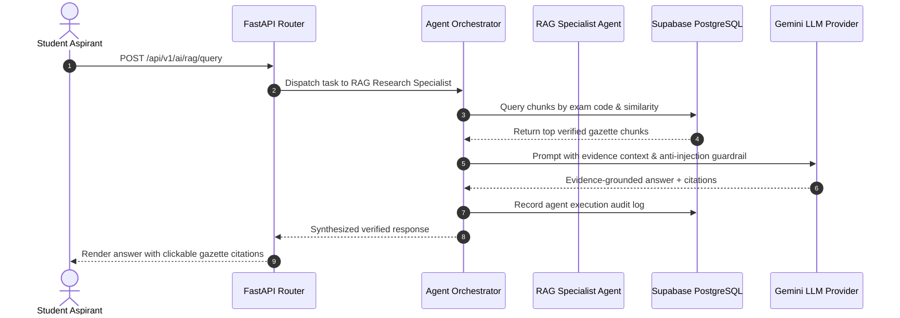

# Govexa System Architecture Documentation

## 1. High-Level Architecture Overview

Govexa is designed as a secure, decoupled full-stack platform for Indian Government Examination career guidance, official notification intelligence, retrieval-augmented document study, and personalized preparation.

```mermaid
graph TD
    User["Aspirant / Educator Browser"] -->|HTTPS / WSS| Vercel["Vercel CDN Edge (React SPA)"]
    Vercel -->|REST API (Bearer JWT)| Render["Render Cloud (FastAPI API Service)"]
    
    subgraph "Backend Services on Render"
        Render --> LLM["LLM Adapter (Google Gemini / Fallback)"]
        Render --> RAG["RAG Engine (Vector / TF-IDF Search)"]
        Render --> EligEngine["Deterministic Eligibility Engine"]
        Render --> PerfEngine["Objective Scoring & Analytics Engine"]
        Worker["Render Background Worker (Watchdog)"] --> Scraper["SSRF-Guarded Scraper & Change Detector"]
        Worker --> OCR["PyPDF2 & OCR Extractor"]
    end

    subgraph "Data & Auth Layer (Supabase)"
        Render -->|PostgreSQL Pooler :6543| SupaDB[("Supabase PostgreSQL Database")]
        Worker -->|PostgreSQL Pooler :6543| SupaDB
        Vercel -.->|Auth SDK (Sign-In/Sign-Up)| SupaAuth["Supabase Auth (GoTrue)"]
        Render -->|Storage API| SupaStorage["Supabase Object Storage (PDFs)"]
    end

    subgraph "External Official Sources"
        Scraper -->|HTTPS Get| UPSC["UPSC (upsc.gov.in)"]
        Scraper -->|HTTPS Get| SSC["SSC (ssc.gov.in)"]
        Scraper -->|HTTPS Get| KEA["KEA / KSET (cetonline.karnataka.gov.in)"]
        Scraper -->|HTTPS Get| ISRO["ISRO (isro.gov.in)"]
    end
```

---

## 2. Multi-Agent Orchestration Engine

Govexa dispatches complex aspirant workflows through 6 specialized, task-focused intelligent agents coordinated by the `AgentOrchestrator`:

1. **Eligibility Analyst Agent**: Evaluates statutory age criteria, community category relaxations (OBC/SC/ST/PwD/Ex-Servicemen), educational degrees, and domicile rules.
2. **Notification Sentinel Agent**: Monitors official commission websites, extracts critical parameters, detects corrigenda changes, and routes high-impact updates to the administrative review queue.
3. **Study Plan Architect Agent**: Constructs personalized multi-week preparation roadmaps dividing complex syllabi into daily actionable study goals.
4. **Pedagogical Assessment Agent**: Synthesizes verified question banks, generates diagnostic mock tests, and creates recovery quizzes from student mistakes.
5. **RAG Research Specialist Agent**: Ingests official PDF gazettes, enforces citation brackets, and confesses a "State of Ignorance" when facts cannot be proven from evidence.
6. **Career Navigation Advisor Agent**: Recommends overlapping examination streams and salary progressions under the 7th Central Pay Commission.



---

## 3. Asynchronous Worker & Monitoring Pipeline

To guarantee sub-100ms API response times, long-running web scraping, PDF downloading, and OCR extraction are executed outside synchronous request paths by `app/worker.py`:

- **Watchdog Scheduler**: Runs every hour (configurable via `MONITORING_INTERVAL_SECONDS`).
- **SSRF Defense**: Validates domain whitelist and blocks loopback, cloud metadata (169.254.169.254), and RFC 1918 subnets.
- **Robots.txt Adherence**: Respects commission crawling rules.
- **Change Detection**: Computes SHA-256 digests. If modified, evaluates semantic diffs.
- **Human-in-the-Loop Review**: High-impact changes (exam dates, age limits, vacancy cuts) are routed to `/admin/review-queue` before publishing to students.
