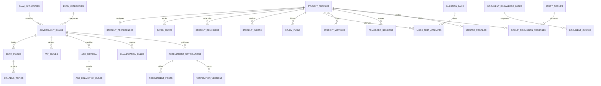

# Govexa Database Schema & Entity-Relationship Documentation

## 1. Relational Database Overview

The Govexa database is hosted on **Supabase PostgreSQL 15+** (with full SQLite fallback in test environments). It uses SQLAlchemy 2.x ORM models and Alembic migrations.

---

## 2. Entity-Relationship (ER) Diagram

---

## 3. Database Table Groups

### Core Examination & Authority Tables
- `exam_authorities`: Statutory recruitment bodies (UPSC, SSC, ISRO, KPSC, NTA, KEA).
- `exam_categories`: Streams (Civil Services, Defense, Banking, Teaching & Lectureship).
- `government_exams`: Authoritative exam records, levels, application fees, dates.
- `exam_stages`: Multi-tier examination phases (Prelims, Mains, Interview).
- `syllabus_topics`: Topic-by-topic breakdowns mapped to specific stages.
- `pay_scales`: 7th Central Pay Commission pay levels, basic pay, metro gross.

### Eligibility Engine Tables
- `qualification_rules`: Degree levels, major stream requirements, percentage cutoffs.
- `age_criteria`: Base statutory age limits for General category candidates.
- `age_relaxation_rules`: Permitted extensions for OBC (+3), SC/ST (+5), PwD (+10), Ex-Servicemen.
- `community_domicile_rules`: State domicile and local language requirements.

### Notification & Monitoring Tables
- `official_sources`: Whitelisted URLs, portal types, active watchdog status.
- `recruitment_notifications`: Live recruitment openings, total posts, dates, official PDF link.
- `recruitment_posts`: Post names, departmental divisions, reservation quotas.
- `notification_versions`: Semantic changes, corrigenda diffs, impact rating.
- `extraction_review_items`: Human-in-the-loop administrative approval queue.

### AI RAG & Preparation Tables
- `document_knowledge_bases`: Ingested gazettes and syllabi with SHA-256 hashes.
- `document_chunks`: Extracted text fragments, token counts, and source citations.
- `question_bank`: Tagged multiple-choice questions with verified correct options and explanations.
- `mock_tests`: Standardized tests, duration, positive marks, negative penalty.
- `mock_test_attempts`: Student scores, accuracy percentage, time spent, weak topics.
- `student_mistakes`: Concept error logs, chosen vs correct options, resolution flags.
- `student_study_goals`: Daily target study hours vs actual completed hours.
- `pomodoro_sessions`: 25-minute focus intervals logged per student.
- `study_streaks`: Daily consecutive learning habits.
- `agent_execution_audits`: Audit telemetry of the 6 specialized agent runs.

### Community & Mentorship Tables (Part 5)
- `study_groups`: Peer collaboration circles by target exam code.
- `group_discussion_messages`: Discussion threads with verified mentor badges and anti-XSS protection.
- `mentor_profiles`: Certified educator credentials, institutions, and ratings.
